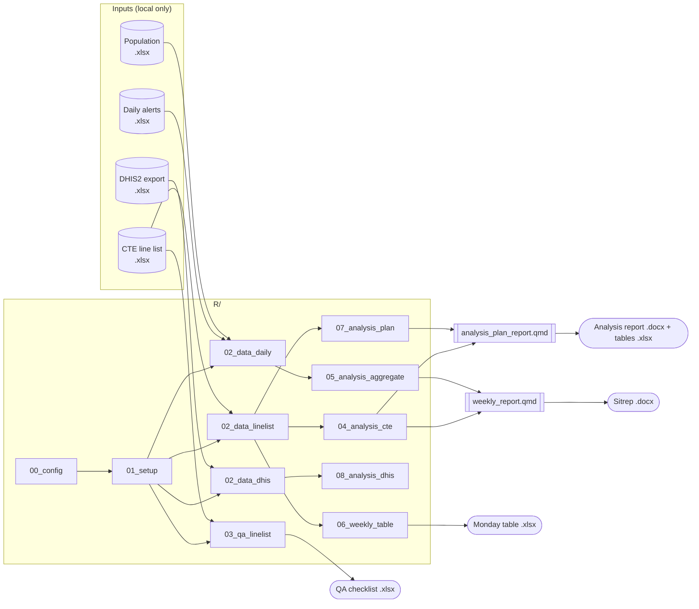

<div align="center">

# Ebola Bundibugyo — Mongbwalu (DRC)

**Reproducible epidemiological analysis pipeline for the MSF Ebola treatment centre (CTE) of Mongbwalu, Ituri, Democratic Republic of the Congo**

[](https://github.com/Abson-dev/ebola-mongbwalu-drc/actions/workflows/ci.yml)


[Quick start](#quick-start) · [Pipeline](#pipeline) · [Outputs](#outputs) · [Data protection](#data-protection) · [Documentation](#documentation) · [En bref (FR)](#en-bref-français)

</div>

---

## Context

In 2026 an outbreak of **Ebola virus disease caused by *Bundibugyo ebolavirus*** affected the Mongbwalu health zone (Ituri province, DRC). Médecins Sans Frontières (MSF, Operational Centre Geneva) runs the Ebola treatment centre (*Centre de Traitement Ebola*, CTE) at the Mongbwalu general referral hospital.

This repository turns the daily CTE line list (MSF EVD line list template v4.4) and surveillance data into:

- a **weekly epidemiological sitrep** (Word) for the coordination and health authorities;
- a **descriptive and bivariate analysis report** that implements the analysis plan of Dr Abdul Salam Mbengue;
- a **data quality checklist** returned to the data entry team every day;
- a **two-week comparison table** for the Monday coordination meeting;
- exploratory **DHIS2 analyses** (epidemic curves by health area, transmission chains, Rt).

All patient-level data stays on the analyst's machine. Only code, configuration and documentation are versioned.

## Quick start

### 1. Requirements

| Tool | Version | Notes |
|---|---|---|
| [R](https://cran.r-project.org) | ≥ 4.3 | Windows: R ≥ 4.2 (UTF-8) is required for accented labels |
| [Quarto](https://quarto.org) | ≥ 1.4 | bundled with RStudio ≥ 2023.06 |
| RStudio | recommended | open `ebola-mongbwalu-drc.Rproj` |

```r
# Once per machine
source("scripts/install_packages.R")
```

### 2. Add the data (never committed)

```
data/
├── linelist/      <- CTE line list export(s) .xlsx (the most recent file is used)
├── daily/         <- "Daily data entry.xlsx"                     (optional)
├── population/    <- "Population_AS2026_Ituri_dhis2.xlsx"        (optional)
└── dhis2/         <- DHIS2 line list export .xlsx               (R/08 only)
```

See [`data/README.md`](data/README.md) for the expected sheets and columns.

### 3. Run

| Task | Command (from the project root) | Output |
|---|---|---|
| Weekly sitrep | `Rscript scripts/render.R weekly` | `output/reports/Sitrep_Hebdomadaire_Epidemio_S<ww>_<date>.docx` |
| Analysis plan report | `Rscript scripts/render.R analysis_plan` | `output/reports/Analyse_LineList_Mongbwalu_S<ww>_<date>.docx` + `_tableaux.xlsx` |
| Daily data quality | `Rscript R/03_qa_linelist.R` | `output/data quality/<date>_ll_qa.xlsx` |
| Monday table | `Rscript R/06_weekly_table.R` | `output/weekly summary/<date>_weekly_summary.xlsx` |
| DHIS2 exploration | open `R/08_analysis_dhis.R` and run interactively | figures, Rt |

A past week can be rendered by passing its last day (a Sunday): `Rscript scripts/render.R weekly 2026-11-08`. RStudio users can simply source `scripts/render_weekly.R` or `scripts/render_analysis_plan.R`.

### 4. Try it without real data

```bash
Rscript scripts/make_synthetic_data.R            # writes data-synthetic/ (fake patients)
EBOLA_DATA_DIR=data-synthetic Rscript scripts/render.R analysis_plan 2026-11-08
```

## Pipeline



Design principles:

- **Single configuration** — paths and analysis parameters live in [`R/00_config.R`](R/00_config.R); the data and output folders can be redirected with the `EBOLA_DATA_DIR` / `EBOLA_OUTPUT_DIR` environment variables.
- **No hard-coded patient decisions in code** — manual corrections and verified QA exceptions are kept in [`config/manual_corrections.csv`](config/manual_corrections.csv) and [`config/qa_exceptions.csv`](config/qa_exceptions.csv), with a reason for each line.
- **Reproducible reporting period** — the report date defaults to the end (Sunday) of the last complete epidemiological week (weeks start on Monday, labelled `2026-S45`).
- **Tested** — unit tests for every helper, and end-to-end tests that run the whole pipeline on synthetic data ([`tests/`](tests/)).
- **Auditable history** — the first commit contains the original scripts unchanged; every later change is reviewable in the git history and summarised in [`CHANGELOG.md`](CHANGELOG.md).

## Repository structure

```
.
├── R/
│   ├── 00_config.R              # paths and parameters
│   ├── 01_setup.R               # packages, themes, reporting period
│   ├── 02_data_linelist.R       # CTE line list + bed occupancy cleaning
│   ├── 02_data_daily.R          # surveillance alerts + population
│   ├── 02_data_dhis.R           # DHIS2 line list cleaning
│   ├── 03_qa_linelist.R         # data quality checks  (standalone)
│   ├── 04_analysis_cte.R        # CTE indicators for the sitrep
│   ├── 05_analysis_aggregate.R  # alert indicators for the sitrep
│   ├── 06_weekly_table.R        # Monday two-week table (standalone)
│   ├── 07_analysis_plan.R       # analysis plan (Dr A. S. Mbengue)
│   ├── 08_analysis_dhis.R       # DHIS2: curves, chains, Rt (exploratory)
│   └── funcs/                   # documented helper functions
├── reports/                     # Quarto reports + Word reference template
├── scripts/                     # render, synthetic data, package installation
├── config/                      # manual corrections, QA exceptions (CSV)
├── tests/testthat/              # unit and end-to-end tests
├── docs/                        # analysis plan mapping, QA rules, pipeline
├── data/                        # INPUT DATA — git-ignored
└── output/                      # GENERATED FILES — git-ignored
```

## Outputs

| Report | Content |
|---|---|
| **Weekly sitrep** | Highlights · alerts (if surveillance data is available) · CTE activity table (3 weeks + cumulative) · admissions epicurve · bed occupancy and length of stay · exits and case fatality ratio (Wilson 95% CI) · age/sex, pregnancy, under-5 trend · origin by health area |
| **Analysis plan report** | Key figures (cases, confirmed, health-care workers, deaths) · last week · socio-demographics of confirmed cases (age statistics, groups, sex, pyramid, occupation, pregnancy) · residence · epidemic curves (notification, daily/weekly deaths) · clinical and haemorrhagic signs · mortality by status and health area · laboratory · delay to care · bivariate analyses (crude OR, χ²/Fisher) for confirmation and death · missing-data assessment. All tables are also exported to Excel. |
| **QA checklist** | ~30 consistency rules (duplicates, impossible dates, exit/status mismatch, lab results vs. classification, CT values, missing demographics/geography…) — see [`docs/data-quality-rules.md`](docs/data-quality-rules.md) |

## Data protection

> [!CAUTION]
> The line list contains **identifying and clinical information** about patients and their relatives. It must never be pushed to GitHub, attached to an issue, or pasted into a pull request.

Several safeguards are in place (details in [`SECURITY.md`](SECURITY.md)):

1. `.gitignore` excludes `data/`, `output/`, `private/` and all spreadsheet/document formats;
2. a **pre-commit hook** ([`.githooks/pre-commit`](.githooks/pre-commit)) refuses to commit data files — enable it once with `git config core.hooksPath .githooks`;
3. the **CI data guard** fails if a data file is ever tracked;
4. CI and demos run exclusively on **synthetic data** generated by [`scripts/make_synthetic_data.R`](scripts/make_synthetic_data.R).

## Documentation

- [`docs/analysis-plan.md`](docs/analysis-plan.md) — analysis plan and the mapping of each requested variable to the line list
- [`docs/data-quality-rules.md`](docs/data-quality-rules.md) — every QA rule, its logic and message
- [`docs/pipeline.md`](docs/pipeline.md) — data flow, key definitions (case status, exits, reporting periods), how to extend the pipeline
- [`data/README.md`](data/README.md) — expected input files
- [`CONTRIBUTING.md`](CONTRIBUTING.md) — development workflow, style, tests

## En bref (français)

Ce dépôt contient le pipeline d'analyse épidémiologique du **CTE MSF de Mongbwalu** (MVE Bundibugyo, Ituri, RDC) :

- **Sitrep hebdomadaire** : `Rscript scripts/render.R weekly`
- **Rapport du plan d'analyse** (Dr A. S. Mbengue) : `Rscript scripts/render.R analysis_plan`
- **Contrôle qualité quotidien** de la line list : `Rscript R/03_qa_linelist.R`
- **Tableau du lundi** (comparaison sur 2 semaines) : `Rscript R/06_weekly_table.R`

Placez la line list exportée (.xlsx) dans `data/linelist/` : le fichier le plus récent est utilisé automatiquement. **Les données patients ne sont jamais versionnées** (voir [`SECURITY.md`](SECURITY.md)).

## Credits

| Role | Person |
|---|---|
| Original pipeline (sitrep, QA, DHIS2 analyses) | Stephanie Ngai — Epidemiologist, MSF OCG |
| Analysis plan | Dr Abdul Salam Mbengue |
| Refactoring, analysis plan implementation, tests, CI, documentation | Aboubacar Hema |

Field data: CTE Mongbwalu clinical and data teams, Mongbwalu health zone. Please cite this work using [`CITATION.cff`](CITATION.cff).

## License

Copyright © 2026 Médecins Sans Frontières (OCG) and contributors. All rights reserved — see [`LICENSE.md`](LICENSE.md). Reuse of the code requires prior agreement; outbreak data is never covered by any license granted here.
